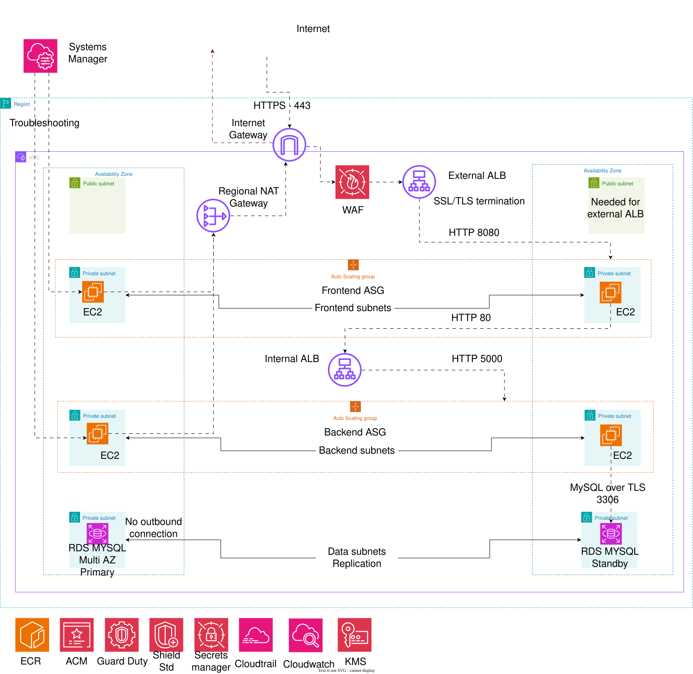

# SecureVault — Secure AWS Three-Tier Architecture


A security-focused AWS infrastructure project that deploys a containerized secrets-management application using Terraform. The project demonstrates network segmentation, private application and database tiers, least-privilege IAM, application-level encryption, AWS Secrets Manager, AWS WAF, audit logging, threat detection, and infrastructure monitoring.

The main focus is the **AWS architecture, infrastructure security, and repeatable Infrastructure as Code deployment**. The application provides a workload through which these controls can be demonstrated.

---

## Table of Contents

- [Project Overview](#project-overview)
- [Architecture](#architecture)
  - [Architecture Diagram](#architecture-diagram)
  - [Request Flow](#request-flow)
  - [VPC and Subnet Layout](#vpc-and-subnet-layout)
  - [Security Group Traffic Flow](#security-group-traffic-flow)
- [Application Overview](#application-overview)
  - [Frontend and Backend](#frontend-and-backend)
  - [Authentication and Vault Encryption](#authentication-and-vault-encryption)
  - [Application Secrets](#application-secrets)
- [Infrastructure and Deployment](#infrastructure-and-deployment)
  - [Compute and Auto Scaling](#compute-and-auto-scaling)
  - [Load Balancers](#load-balancers)
  - [Container Image Deployment](#container-image-deployment)
- [Security Controls](#security-controls)
  - [Network Isolation](#network-isolation)
  - [IAM and Instance Access](#iam-and-instance-access)
  - [Container Hardening](#container-hardening)
  - [AWS WAF and Image Scanning](#aws-waf-and-image-scanning)
  - [Encryption](#encryption)
- [Logging, Monitoring, and Threat Detection](#logging-monitoring-and-threat-detection)
- [Terraform Structure](#terraform-structure)
- [Prerequisites](#prerequisites)
- [Resources Managed Outside Terraform](#resources-managed-outside-terraform)
- [Build and Deploy](#build-and-deploy)
- [Application Access and Operations](#application-access-and-operations)
- [Validation Checklist](#validation-checklist)
- [Destroying the Infrastructure](#destroying-the-infrastructure)
- [Current Limitations and Future Work](#current-limitations-and-future-work)
- [License](#license)

---

## Project Overview

SecureVault is a web-based secrets-management application. Users can store, manage, retrieve, and delete sensitive information such as passwords and private credentials. Each vault entry is encrypted by the backend before it is stored in MySQL. User login passwords are stored as secure hashes, and a separate key signs Flask session cookies.

The application is split into three logical tiers:

| Tier | Technology | Responsibility |
|---|---|---|
| Frontend | Nginx | Serves the web interface and proxies API requests to the backend |
| Backend | Python, Flask, Gunicorn | Authentication, session handling, vault encryption/decryption, and database operations |
| Database | Amazon RDS for MySQL 8.4 | Stores user accounts and encrypted vault entries |

The frontend and backend are packaged as separate Docker images. The AWS infrastructure is provisioned through reusable Terraform modules. Application development was assisted by Claude AI.

### Project objectives

- Separate the public entry point, frontend, backend, and database into network tiers.
- Keep EC2 instances and the database private; do not expose them directly to the internet.
- Restrict tier-to-tier communication to explicitly required ports and security-group references.
- Use EC2 IAM roles instead of static AWS credentials on instances.
- Retrieve application keys and database credentials through AWS Secrets Manager.
- Encrypt vault entries before storing them in MySQL.
- Protect the public application entry point with AWS WAF.
- Collect AWS account activity and load-balancer/database logs.
- Monitor selected infrastructure health metrics with CloudWatch.
- Manage the AWS infrastructure using Terraform modules.

## Architecture

### Architecture Diagram

The following diagram is the supplied project architecture image. It is stored in the repository at `docs/images/securevault-architecture.png`.



### Request Flow

1. A user opens `https://vault.mostafa-medhat.online`.
2. The internet-facing public Application Load Balancer (ALB) terminates HTTPS on port `443` using the ACM certificate. AWS WAF is associated with this ALB; WAF is a protection layer, not a separate network hop.
3. The public ALB forwards HTTP traffic on port `8080` to frontend EC2 instances in private frontend subnets.
4. Nginx serves the UI and proxies API requests to `backend.vault.internal`.
5. The private Route 53 hosted zone resolves `backend.vault.internal` to the internal ALB.
6. Frontend EC2 instances communicate with the internal ALB over HTTP port `80`.
7. The internal ALB forwards HTTP traffic on port `5000` to backend EC2 instances in private backend subnets.
8. The backend connects to RDS MySQL over TLS on port `3306`. The database parameter group requires secure transport.
9. RDS runs as a Multi-AZ DB instance deployment. AWS manages the standby in another Availability Zone for failover; it is not a read replica for normal application reads.

The Regional NAT Gateway provides outbound connectivity for private application subnets. The data subnets have no default internet route. EC2 instances use IAM roles and Systems Manager Session Manager; public EC2 IPs and inbound SSH are not required.

> **Transport-encryption boundary:** HTTPS is used between the browser and public ALB, and TLS is used between the backend and RDS. The public ALB-to-frontend, frontend-to-internal-ALB, and internal-ALB-to-backend paths currently use HTTP. Private subnets and security groups restrict access, but they do not encrypt those HTTP connections.

### VPC and Subnet Layout

The project VPC uses CIDR `10.0.0.0/16` and contains eight `/24` subnets across two Availability Zones.

| Subnet tier | Count | Purpose |
|---|---:|---|
| Public | 2 | Public ALB and internet-facing routing |
| Frontend | 2 | Frontend EC2 instances |
| Backend | 2 | Internal ALB and backend EC2 instances |
| Data | 2 | RDS database subnet group |

Networking components:

- An Internet Gateway provides internet connectivity for the public subnets.
- A **Regional NAT Gateway** provides outbound connectivity for private application subnets.
- Public, private-application, and data route tables separate routing behavior.
- Data subnets have no default route to the internet.
- VPC DNS support and DNS hostnames are enabled.
- The private Route 53 hosted zone is `vault.internal`, with `backend.vault.internal` pointing to the internal ALB.
- VPC Flow Logs are not currently enabled.

### Security Group Traffic Flow

Security groups use references to adjacent security groups rather than broad internal CIDR rules for application-tier communication.

| Source | Destination | Protocol / port | Purpose |
|---|---|---:|---|
| Internet | Public ALB | TCP 443 | Public HTTPS access |
| Public ALB | Frontend instances | TCP 8080 | Forward web requests |
| Frontend instances | Internal ALB | TCP 80 | Internal API requests |
| Internal ALB | Backend instances | TCP 5000 | Forward API requests |
| Backend instances | RDS | TCP 3306 | MySQL over TLS |

The frontend and backend instances also require outbound HTTPS access to AWS services and package/image sources through the Regional NAT Gateway. The database security group accepts inbound MySQL only from the backend security group and has no configured egress rules.

## Application Overview

### Frontend and Backend

**Frontend**

- Nginx serves the web interface.
- JavaScript sends API requests to the backend.
- Nginx reverse-proxies API requests to `http://backend.vault.internal`.
- The frontend does not connect directly to MySQL or retrieve application secrets from Secrets Manager.

**Backend**

The backend uses Python, Flask, Gunicorn, PyMySQL, bcrypt, `cryptography`/Fernet, and boto3. It handles authentication, session management, vault encryption/decryption, database operations, and retrieval of the required AWS secrets.

### Authentication and Vault Encryption

- User login passwords are hashed using bcrypt before being stored in MySQL.
- Flask uses a separate session-signing key to sign session cookies.
- The backend encrypts each user-saved vault secret with Fernet before storing the encrypted value in MySQL.
- When a user requests a secret, the backend verifies ownership and decrypts the value before returning it.

The Fernet key is required to decrypt existing vault entries. Losing it means those entries cannot be decrypted. Key rotation therefore requires a migration plan that preserves the ability to decrypt and re-encrypt existing records.

### Application Secrets

The application secret in AWS Secrets Manager contains two application keys:

| Secret value | Purpose |
|---|---|
| `fernet_key` | Encrypts and decrypts user-saved vault entries |
| `session_key` | Signs Flask session cookies |

Terraform generates the application keys and creates the application secret. The backend retrieves the values at startup using its EC2 instance role. Backend instances use the same application keys so that any healthy backend instance can decrypt existing entries and validate sessions.

RDS separately manages its master password and stores the database credentials in Secrets Manager. The backend role can retrieve the application secret and RDS-managed database secret; the frontend role cannot retrieve application secrets.

> Secrets Manager stores the application secret values. AWS KMS provides the service-side encryption at rest for Secrets Manager secret values using the AWS-managed key by default. The Fernet key is an application encryption key, not a KMS key.

## Infrastructure and Deployment

### Compute and Auto Scaling

The frontend and backend each have a separate EC2 Launch Template and Auto Scaling Group (ASG). Both groups span two Availability Zones.

| ASG setting | Value |
|---|---:|
| Minimum capacity | 2 instances |
| Desired capacity | 2 instances |
| Maximum capacity | 4 instances |

The ASGs use CPU target tracking, Elastic Load Balancing health checks, and rolling instance refresh configuration. The EC2 user-data scripts install/start Docker, authenticate to ECR using the instance role, pull the configured image, and start the container.

Instance configuration includes:

- Encrypted `gp3` root EBS volumes.
- IMDSv2 required.
- Metadata hop limit 1 for frontend instances and 2 for backend instances. The backend container needs access to instance-role credentials to retrieve its required secrets.
- No public EC2 IP addresses and no inbound SSH rule.

### Load Balancers

**Public ALB**

- Internet-facing and deployed in the two public subnets.
- HTTPS listener on port `443` using the ACM certificate.
- TLS 1.3/TLS 1.2 security policy.
- Forwards HTTP to frontend targets on port `8080`.
- Frontend health check path: `/healthz` (HTTP 200 expected).

**Internal ALB**

- Internal/private ALB deployed in backend subnets.
- HTTP listener on port `80`.
- Forwards HTTP to backend targets on port `5000`.
- Backend health check path: `/api/health` (HTTP 200 expected).

Both ALBs are configured to drop invalid HTTP header fields. Both send access logs to the manually created S3 bucket `depi-alb-logs`, using the `public-alb` and `internal-alb` prefixes respectively.

There is currently **no HTTP port 80 listener on the public ALB**, so HTTP-to-HTTPS redirection is not configured.

### Container Image Deployment

The ECR repositories `vault-frontend` and `vault-backend` are created manually and use immutable image tags. Images are built and pushed outside Terraform. ECR Enhanced Scanning on push is also enabled manually for both repositories and is backed by Amazon Inspector.

The EC2 user-data scripts pull the image references supplied by the Terraform configuration. To deploy a new image version:

1. Build the updated frontend and/or backend Docker image.
2. Authenticate Docker to ECR and push the image with a **new tag** (existing tags are immutable).
3. Update the corresponding image tag in the Terraform root configuration.
4. Run `terraform plan` and review the Launch Template/user-data changes.
5. Run `terraform apply` to publish the updated Launch Template configuration.
6. Refresh the corresponding ASG so replacement EC2 instances start with user data that pulls the new image.
7. Verify the replacement instances and their ALB target health before considering the deployment complete.

Uploading an image to ECR alone does not update existing EC2 instances, create a Launch Template version, or start an ASG refresh. Refresh only the tier whose image reference changed.

## Security Controls

### Network Isolation

- Frontend and backend EC2 instances run in private subnets.
- The internal ALB is private.
- RDS is not publicly accessible and resides in private data subnets.
- Security groups allow only the required tier-to-tier traffic shown in [Security Group Traffic Flow](#security-group-traffic-flow).
- Data subnets have no default internet route.

### IAM and Instance Access

Separate IAM roles and instance profiles are configured for frontend and backend EC2 instances.

**Both roles:**

- Include `AmazonSSMManagedInstanceCore` for Systems Manager Session Manager access.
- Have ECR permissions required to authenticate and pull their respective image.
- Use repository-scoped image-pull permissions. `ecr:GetAuthorizationToken` uses Resource `*` as required by the ECR API.

**Backend role only:**

- Can retrieve the specific application secret and RDS-managed database secret.

**Frontend role:**

- Cannot retrieve application or database secrets.

No static AWS access keys are stored in application images or user-data scripts. EC2 uses temporary credentials from its instance profile. The operator still needs AWS credentials to run Terraform and to build/push ECR images.

Administrative access is through Systems Manager Session Manager. SSH is not used: there are no public EC2 IPs and no inbound TCP port `22` rule.

### Container Hardening

Both containers are started with runtime restrictions configured through EC2 user data:

- Read-only root filesystem.
- Restricted temporary `/tmp` filesystem.
- All Linux capabilities dropped.
- Privilege escalation disabled.
- Process and memory limits.
- Docker `json-file` log rotation with `max-size=10m` and `max-file=3` (approximately 30 MB retained per container).

The backend uses a Distroless runtime image and runs as a non-root user. The frontend uses a hardened Nginx image.

### AWS WAF and Image Scanning

A Regional AWS WAF Web ACL is associated with the public ALB. It includes:

- AWS Managed Common Rule Set.
- AWS Managed Known Bad Inputs rule group.
- Amazon IP Reputation List managed rule group.
- A rate-based rule aggregated by source IP that blocks requests above 1,000 requests in a 300-second evaluation window.

The rate-based rule is general IP-based protection. It is **not** scoped specifically to the login endpoint and is not per-account throttling.

ECR Enhanced Scanning on push is enabled manually for both repositories and is backed by Amazon Inspector. Trivy image scans have also been performed; findings requiring review/remediation remain. Do not describe all findings as fixed unless you have evidence that they were remediated.

AWS Shield Standard is automatically included by AWS; it was not separately provisioned as a project resource.

### Encryption

| Layer / service | Current protection |
|---|---|
| User vault entries | Application-level Fernet encryption before database storage |
| Browser to public ALB | HTTPS using ACM certificate and ALB TLS policy |
| Backend to RDS | TLS with RDS CA verification; RDS requires secure transport |
| RDS storage | Encryption at rest using the AWS-managed RDS KMS key by default; no custom KMS key ID is specified |
| EC2 root volumes | Encrypted `gp3` EBS volumes |
| S3 buckets | Default SSE-S3 encryption, not SSE-KMS |
| Secrets Manager | Secret values encrypted at rest using the AWS-managed key by default |

KMS encryption at rest and TLS encryption in transit are different controls. KMS does not encrypt the HTTP connections between the load balancers and application tiers.

## Logging, Monitoring, and Threat Detection

### ALB Access Logs

Both ALBs deliver access logs to the manually created private S3 bucket `depi-alb-logs`:

- `public-alb/` — public ALB logs.
- `internal-alb/` — internal ALB logs.

The bucket and its log-delivery policy are configured manually. Terraform configures both ALBs to deliver logs to the bucket and prefixes.

### CloudTrail

The Terraform-managed CloudTrail trail is configured for:

- Multi-region activity.
- Global service events.
- All management read and write events.
- Log file integrity validation.

The trail delivers logs to the manually created private S3 bucket `depi-cloudtrail`. CloudTrail records AWS account/API management activity; it does not record application-level user actions inside SecureVault.

### GuardDuty

Amazon GuardDuty is enabled through Terraform using an `aws_guardduty_detector` resource in the project region. It provides threat detection for supported AWS activity and data sources.

### CloudWatch Alarms and RDS Logs

Five CloudWatch metric alarms are configured:

| Alarm | Threshold | Evaluation |
|---|---|---|
| Public ALB unhealthy targets | At least 1 unhealthy target | 2 evaluation periods |
| Internal ALB unhealthy targets | At least 1 unhealthy target | 2 evaluation periods |
| Public ALB ELB-generated 5xx errors | At least 5 errors in a 5-minute period | 1 evaluation period |
| RDS CPU utilization | At least 80% | 2 evaluation periods |
| RDS free storage | At or below 2 GiB | 2 evaluation periods |

Missing metric data is treated as `notBreaching`. The alarms currently change state only; **SNS/email notifications are not configured**.

RDS error and slow-query logs are exported to CloudWatch Logs with 30-day retention. Slow-query logging is enabled with a 2-second threshold.

## Terraform Structure

The Terraform configuration is located in `terraform/`.

```text
terraform/
├── backend.tf
├── provider.tf
├── main.tf
├── outputs.tf
├── cloudtrail.tf
├── cloudwatch-alarms.tf
├── guardduty.tf
├── modules/
│   ├── alb/
│   ├── asg/
│   ├── iam/
│   ├── networking/
│   ├── rds/
│   ├── route53-private-zone/
│   ├── secrets-manager/
│   ├── security-groups/
│   └── waf/
└── templates/
    ├── backend_user_data.sh.tftpl
    └── frontend_user_data.sh.tftpl
```

The root module connects the reusable modules and contains the fixed project configuration in `main.tf`.

### Terraform requirements

| Component | Version |
|---|---:|
| Terraform | `1.17.1` |
| AWS provider | `6.71.0` |
| Random provider | `3.9.1` |

The project uses an S3 remote backend with native S3 lockfile support (`use_lockfile = true`). The backend bucket must exist before `terraform init`.

### Modules

| Module | Responsibility |
|---|---|
| `alb` | Public and internal Application Load Balancers, listeners, target groups, and health checks |
| `asg` | EC2 Launch Templates and Auto Scaling Groups |
| `iam` | EC2 roles, instance profiles, and scoped policies |
| `networking` | VPC, subnets, gateways, and route tables |
| `rds` | MySQL DB instance, subnet group, parameter group, and log groups |
| `route53-private-zone` | Private hosted zone and backend alias record |
| `secrets-manager` | Application secret containing generated Fernet and session keys |
| `security-groups` | Tier-specific security groups and rules |
| `waf` | Regional Web ACL and managed/rate-based rules |

The root configuration also defines CloudTrail, five CloudWatch alarms, and the GuardDuty detector.

### Pre-commit checks

The repository includes pre-commit configuration for Terraform formatting and validation, TFLint, Terraform documentation generation, file hygiene, private-key/AWS credential detection, Gitleaks, and KICS. Confirm that each check has actually been run before claiming it passed.

## Prerequisites

Install and configure:

- Terraform `1.17.1`.
- AWS CLI.
- Docker.
- Git.
- An AWS account and permissions to create the required resources.
- The manually managed S3 buckets and ECR repositories listed below.
- An ACM certificate for `vault.mostafa-medhat.online` in `us-east-2`.
- A registered domain and access to its public DNS configuration.

The Terraform provider and the ACM certificate use `us-east-2`.

Configure AWS CLI credentials using an appropriate profile or environment credentials, then verify the identity:

```bash
aws sts get-caller-identity
```

## Resources Managed Outside Terraform

The project is not deployed exclusively through Terraform. The following resources are created or configured manually; Terraform references them or configures dependent services to use them.

| Resource | Name | Manual work | Terraform relationship |
|---|---|---|---|
| S3 bucket | `depi-terraform-backend` | Create private bucket, enable SSE-S3 and versioning, configure lifecycle rule | Terraform S3 backend references it; bucket/settings are not created by the project configuration |
| S3 bucket | `depi-alb-logs` | Create private bucket and ALB log-delivery bucket policy; enable SSE-S3 | Terraform configures both ALBs to deliver logs using separate prefixes |
| S3 bucket | `depi-cloudtrail` | Create private bucket and CloudTrail bucket policy; enable SSE-S3 | Terraform creates/configures the CloudTrail trail |
| ECR repository | `vault-frontend` | Create repository, enable immutable tags and Enhanced Scanning on push; build and push images | Terraform looks up the repository and references it in frontend user data/IAM |
| ECR repository | `vault-backend` | Create repository, enable immutable tags and Enhanced Scanning on push; build and push images | Terraform looks up the repository and references it in backend user data/IAM |
| ACM certificate | `vault.mostafa-medhat.online` | Request and validate certificate in `us-east-2` | Terraform attaches its ARN to the public ALB HTTPS listener |
| Public domain/DNS | Namecheap | Register/manage domain and create public CNAME | Public DNS points to the Terraform-created public ALB |

### S3 bucket details

All three buckets are private and use default SSE-S3 encryption.

**`depi-terraform-backend`**

- Stores Terraform state at `tf-state/terraform.tfstate`.
- Versioning is enabled.
- Native S3 state locking is enabled with `use_lockfile = true`.
- The `terraform-backend-lifecycle` rule retains the 10 newest noncurrent versions and deletes other noncurrent versions after 30 days.
- Current state object versions have no expiration action.

**`depi-alb-logs`**

- Requires the ALB log-delivery bucket policy.
- Receives public and internal ALB logs under separate prefixes: `public-alb` and `internal-alb`.

**`depi-cloudtrail`**

- Requires the CloudTrail bucket policy.
- Receives logs from the Terraform-managed multi-region trail.

### ECR repositories

Create `vault-frontend` and `vault-backend` manually. Enable immutable image tags and Enhanced Scanning on push for both repositories. Enhanced Scanning is backed by Amazon Inspector. Publish a new tag for each image update; an existing immutable tag cannot be overwritten.

### ACM certificate and public DNS

Request and validate an ACM certificate for `vault.mostafa-medhat.online` in `us-east-2`. After Terraform creates the public ALB, create or update the Namecheap DNS record:

| Type | Host | Value |
|---|---|---|
| CNAME | `vault` | Public ALB DNS name from Terraform output |

The private hosted zone `vault.internal` and `backend.vault.internal` alias are Terraform-managed.

## Build and Deploy

The manual prerequisites above must exist before the first Terraform deployment.

### 1. Build and push the application images

Authenticate Docker to ECR (replace the account ID):

```bash
aws ecr get-login-password --region us-east-2 \
  | docker login --username AWS --password-stdin <ACCOUNT_ID>.dkr.ecr.us-east-2.amazonaws.com
```

Build the frontend and backend images using the Dockerfiles and build contexts in the application source. The frontend image must be built with the internal backend URL `http://backend.vault.internal` and the VPC DNS resolver build argument, as shown by the Terraform output `frontend_image_build_command`.

Push the images using the repository names and image tags configured in the Terraform root module:

```bash
docker push <ACCOUNT_ID>.dkr.ecr.us-east-2.amazonaws.com/vault-frontend:<IMAGE_TAG>
docker push <ACCOUNT_ID>.dkr.ecr.us-east-2.amazonaws.com/vault-backend:<IMAGE_TAG>
```

Because tags are immutable, use a new tag for every updated image. Update the corresponding image reference in the Terraform root configuration before applying.

### 2. Initialize Terraform

From the repository root:

```bash
cd terraform
terraform init
```

Terraform connects to the existing S3 backend and initializes the providers and modules.

### 3. Review and apply

```bash
terraform plan
terraform apply
```

Review the plan before confirming the apply. The ASGs are configured with minimum 2, desired 2, and maximum 4 instances across two Availability Zones.

### 4. Review outputs

```bash
terraform output
```

Useful outputs include:

- `application_url`
- `public_alb_dns_name`
- `internal_alb_dns_name`
- `backend_dns_name`
- `rds_address`
- `asg_names`
- `frontend_image` and `backend_image`
- `app_secret_arn` and `rds_master_secret_arn`
- `vpc_id`, `subnet_ids`, and `security_group_ids`

Create or update the Namecheap CNAME using `public_alb_dns_name` if it is not already configured.

### 5. Verify the deployment

Check both ASGs, both ALB target groups, application access, backend secret retrieval, backend-to-RDS TLS connectivity, private DNS resolution, CloudTrail delivery, GuardDuty status, WAF association, and CloudWatch metric/alarm behavior. Treat these as verification steps; do not assume success just because `terraform apply` completed.

## Application Access and Operations

The public application URL is:

`https://vault.mostafa-medhat.online`

Use AWS Systems Manager Session Manager for administrative access to EC2 instances. No SSH key, public EC2 IP, or inbound port 22 rule is required.

### Updating an application image

An ECR push alone does not update running containers. The EC2 user-data scripts pull the image reference configured in the Launch Template when an instance starts.

For an image update, push a new immutable tag, update the relevant image reference in Terraform, run `terraform plan` and `terraform apply`, then start an Instance Refresh for the corresponding ASG. Refresh only the frontend ASG when only the frontend image changed, and only the backend ASG when only the backend image changed. Confirm new instances become healthy in the relevant target group.

## Validation Checklist

Use this checklist to record actual test evidence. It is not a claim that every test has already been completed.

- [ ] Both ASGs have the expected instances and both target groups report healthy targets.
- [ ] The public application is accessible through HTTPS.
- [ ] The internal ALB and backend are not publicly accessible.
- [ ] The database is not publicly accessible; only the backend security group can connect on TCP 3306.
- [ ] Frontend cannot retrieve Secrets Manager secrets; backend can retrieve only the required secret ARNs.
- [ ] Session Manager works and SSH is unavailable.
- [ ] IMDSv2 is required and the configured hop limits are in effect.
- [ ] RDS connections use TLS and certificate verification.
- [ ] WAF managed rules and the general IP-based rate rule behave as expected.
- [ ] ALB access logs and CloudTrail logs are delivered to their S3 buckets.
- [ ] GuardDuty is enabled in the project region.
- [ ] CloudWatch alarms receive metrics and transition as expected.
- [ ] ASG replacement and target recovery have been tested.
- [ ] RDS backup restoration and Multi-AZ failover behavior have been tested and documented.
- [ ] Unit, integration, end-to-end, security, and performance testing has been performed where applicable.

Retain evidence such as CLI output, screenshots, alarm history, WAF test results, and test reports. Do not mark a checkbox complete without evidence.

## Destroying the Infrastructure

From the `terraform/` directory:

```bash
terraform destroy
```

Review the destruction plan before confirming.

Terraform-managed resources include the VPC and networking components, security groups, ALBs, ASGs and EC2 instances, RDS resources, private Route 53 zone/record, application secret, WAF Web ACL, CloudTrail trail, GuardDuty detector, CloudWatch alarms, and associated managed log groups.

The following manually managed resources remain after `terraform destroy`:

- `depi-terraform-backend` and its Terraform state.
- `depi-alb-logs` and its stored access logs.
- `depi-cloudtrail` and its stored CloudTrail logs.
- `vault-frontend` and `vault-backend` ECR repositories and images.
- ACM certificate.
- Namecheap domain and public DNS configuration.

S3 bucket contents and ECR images remain unless deleted manually. Keep the Terraform backend bucket available; do not delete it as part of an application teardown.

**Database warning:** The current RDS configuration uses `skip_final_snapshot = true`. Destroying the RDS instance therefore does not create a final snapshot, and database data will be lost.

**Secrets Manager warning:** The application secret uses a configured recovery window. A secret scheduled for deletion may need to be restored or permanently deleted before a new secret with the same name can be created. Check the actual `recovery_window_in_days` value in the current Terraform configuration before relying on a specific deletion period.

## Current Limitations and Future Work

The project implements a secured three-tier AWS architecture, but the following improvements or validation tasks remain outstanding:

- Internal application traffic between the public ALB/frontend and frontend/internal ALB/backend paths currently uses HTTP rather than TLS.
- The public ALB does not currently have an HTTP port 80 listener for redirecting requests to HTTPS.
- VPC Flow Logs are not enabled.
- The current WAF rate-based rule is general source-IP protection, not login-endpoint-specific or per-account throttling.
- CSRF protection should be reviewed and implemented as appropriate.
- The application currently uses the RDS-managed master credentials; a dedicated least-privilege MySQL application user is a future improvement.
- A rotation process is needed for database credentials, application keys, and the Fernet key. Fernet rotation requires a migration plan for existing encrypted records.
- Trivy findings require review and remediation; the backend base image/runtime should be reviewed and upgraded.
- CloudWatch alarms do not currently publish to SNS or send email notifications.
- Formal unit, integration, end-to-end, security, resilience, and performance testing needs documented evidence.
- An RDS backup restore exercise and disaster-recovery procedure need to be performed and documented.
- AWS Security Hub CSPM and AWS Config may be evaluated.
- VPC endpoints may be evaluated for supported AWS services where they make sense for the design.

The current network design uses a **Regional NAT Gateway**. A separate NAT Gateway per Availability Zone is not listed as a required improvement for this architecture.

## License

This project is licensed under the MIT License. See [LICENSE](LICENSE).
